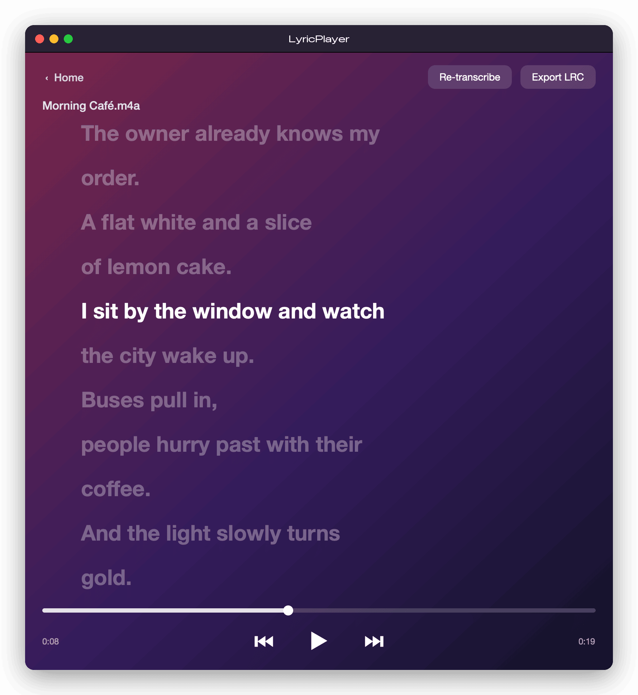
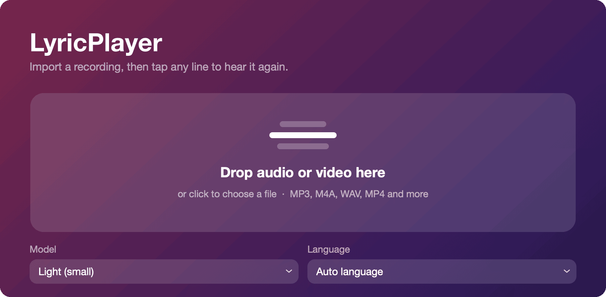
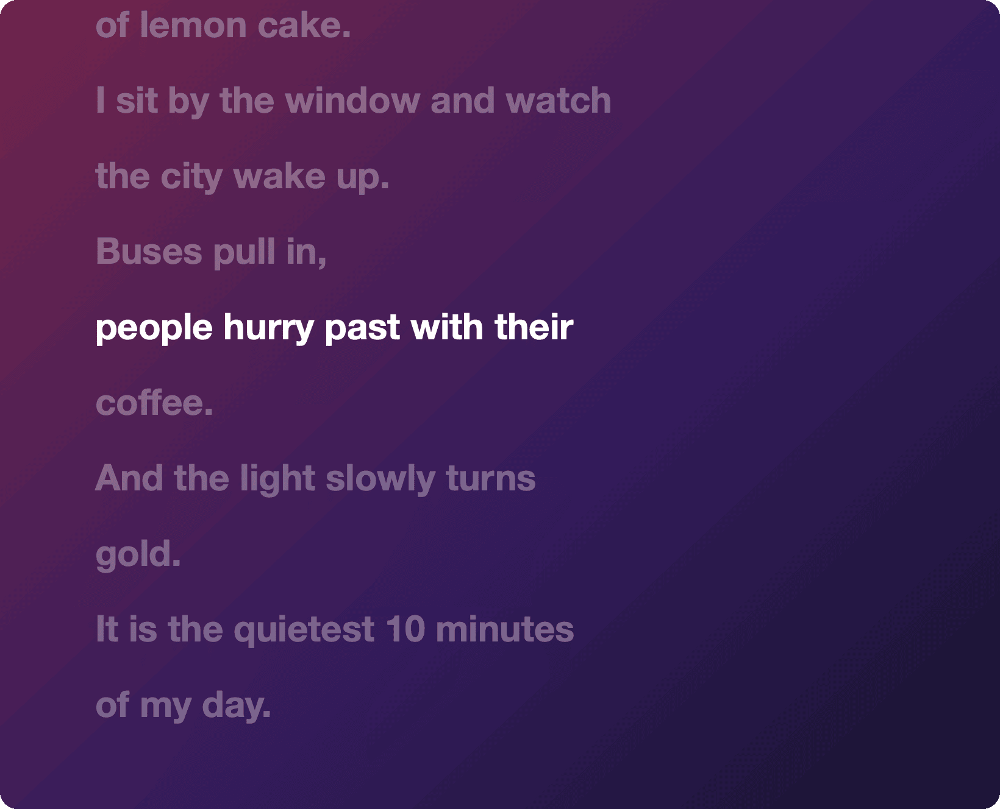
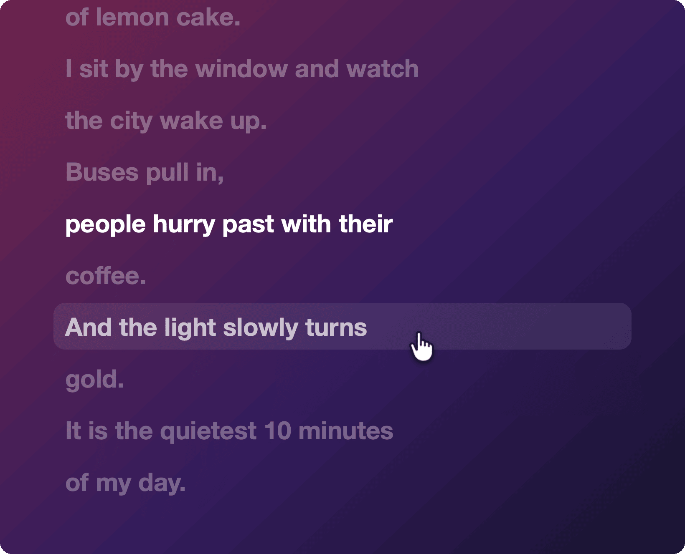
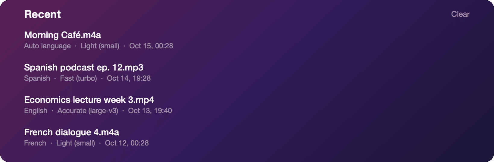

  

<h3 align="center">Drop in any recording. Get lyrics that follow along. Click a line and it plays from there.</h3>

  <a href="https://github.com/binjto-boop/lyricplayer-releases/releases/latest"><b>Download for macOS</b></a>
  &nbsp;·&nbsp;
  <a href="https://github.com/binjto-boop/lyricplayer-releases/releases">Changelog</a>
  &nbsp;·&nbsp;
  <a href="https://github.com/binjto-boop/lyricplayer-releases/issues">Report a bug</a>

  
  
  
  

  LyricPlayer is closed source. This repository is the official download, the changelog and the issue tracker.

 

<table>
<tr>
<td width="42%"></td>
<td valign="middle">

### Drop a file, wait a moment

MP3, M4A, WAV, FLAC, even a video. LyricPlayer writes out every line with
the time it was said. A song, a podcast, a lecture, a listening exam.

It all happens on your Mac. Nothing gets uploaded.

</td>
</tr>
<tr>
<td></td>
<td valign="middle">

### The text keeps up with the audio

The line being spoken lights up and scrolls to the middle. Scroll away to
read ahead and it leaves you alone for a few seconds, then catches up.

</td>
</tr>
<tr>
<td></td>
<td valign="middle">

### Missed something? Click it

Every line is a button. Click one and playback jumps right there.
<kbd>←</kbd> and <kbd>→</kbd> step one line back or forward,
<kbd>Space</kbd> plays and pauses.

Handy when you're learning a language and need that one sentence again.
And again.

</td>
</tr>
<tr>
<td></td>
<td valign="middle">

### Keep what you made

Everything you've transcribed waits under Recent on the home screen. Open it
again and the lyrics are already there, no second wait.

Export LRC saves a standard synced-lyrics file that music players can read.

</td>
</tr>
</table>

 

## Models and languages

The small model comes inside the app and works the moment you open it. Want
better accuracy? Switch to Fast or Accurate and the model downloads once, the
first time you use it.

Language is detected for you, by sampling the whole file instead of just the
first 30 seconds, so a long intro in another language won't fool it. You can
also pick one: English, Chinese (Simplified or Traditional), Cantonese,
Japanese, Korean, French, Spanish or German.

## Install

1. Download `LyricPlayer.x.x.zip` from the [latest release](https://github.com/binjto-boop/lyricplayer-releases/releases/latest) and unzip it.
2. Drag `LyricPlayer.app` into Applications.
3. The first time, right-click the app and choose **Open**. macOS asks because the app isn't from the App Store.

It's a big download (around 650 MB) because the speech model is built in.

## Updates

LyricPlayer checks for new versions by itself once a day. To check now, open
the **LyricPlayer** menu and choose **Check for Updates…**

## Feedback

Found a bug or a file it got wrong? [Open an issue](https://github.com/binjto-boop/lyricplayer-releases/issues).
It helps to say which model and language you picked.

Made by Jtobin

